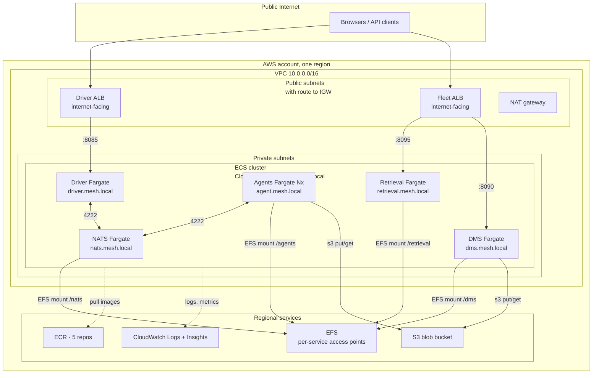
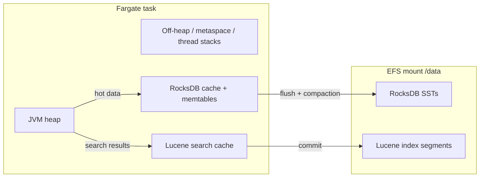
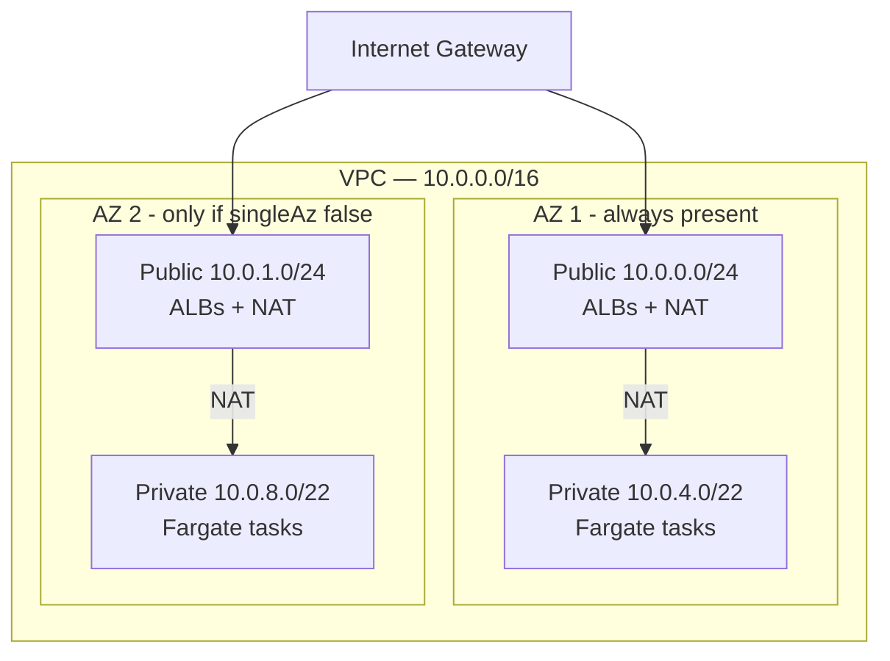
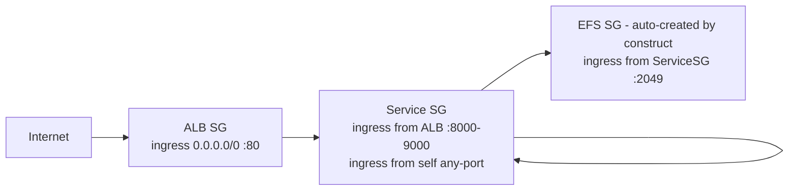
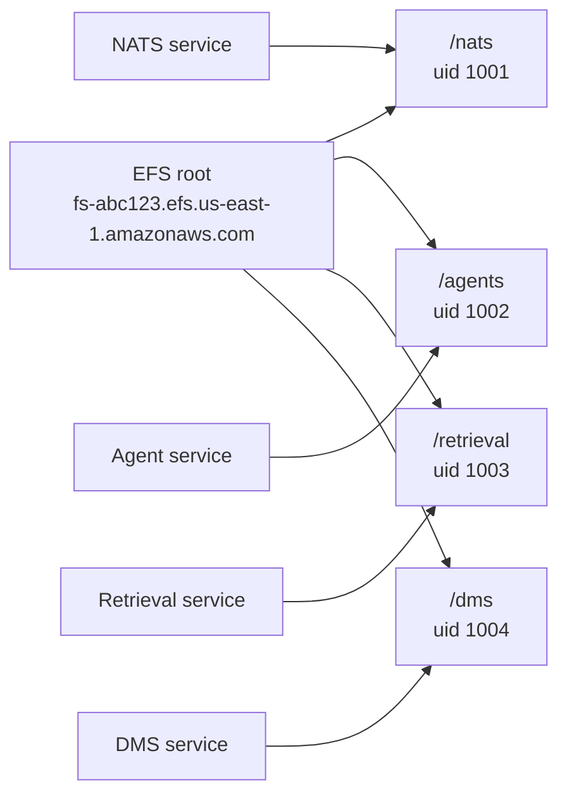
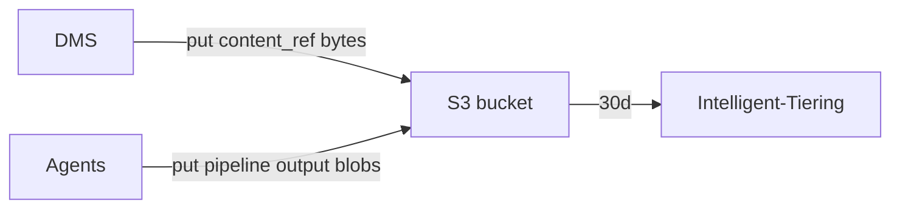
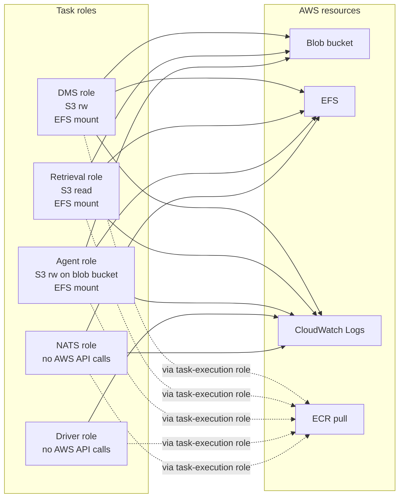
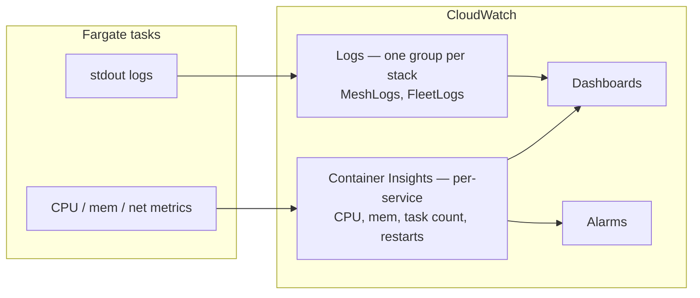
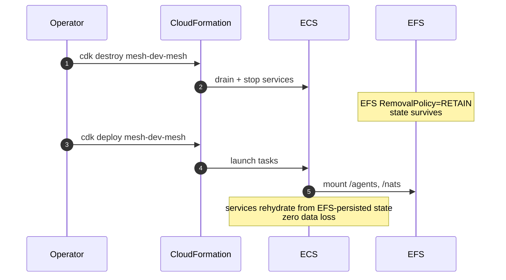
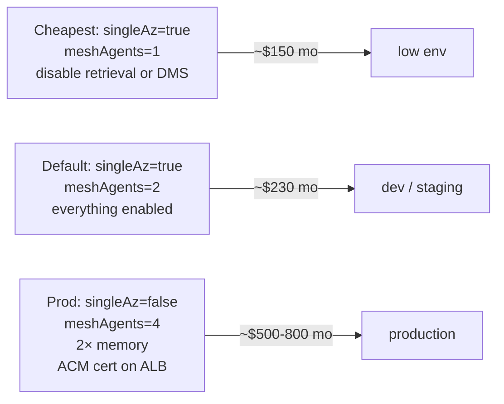

# AWS deployment architecture

Full mapping between mesh runtime concepts and AWS services deployed
by this CDK.

- [1. Topology](#1-topology)
- [2. Service-to-AWS mapping](#2-service-to-aws-mapping)
- [3. Network layout](#3-network-layout)
- [4. State + storage](#4-state--storage)
- [5. IAM boundaries](#5-iam-boundaries)
- [6. Observability](#6-observability)
- [7. Failure modes + recovery](#7-failure-modes--recovery)
- [8. Cost model](#8-cost-model)
- [9. Deploy-sequence tradeoffs](#9-deploy-sequence-tradeoffs)

## 1. Topology

## 2. Service-to-AWS mapping

Every hitorro concept has a specific AWS resource behind it:

| Mesh concept | AWS resource | Notes |
|---|---|---|
| **Mesh driver** — Spring Boot service that dispatches jobs, hosts pipeline REST + UI | ECS Fargate service (1 task) fronted by an internet-facing ALB | Stateless; scale horizontally by bumping `desiredCount` |
| **Mesh agent** — Spring Boot service that executes pipeline nodes, hosts KV state | ECS Fargate service (N tasks) — private subnets only | Stateful via EFS mount `/agents` (RocksDB + Lucene). Number set by `meshAgents` context |
| **NATS** — control-plane messaging + JetStream shuffle | ECS Fargate service (1 task), CloudMap DNS `nats.mesh.local` | JetStream state persisted to EFS `/nats`. HA cluster is a follow-up |
| **KV store** — RocksDB embedded in each agent | EFS access point `/agents`, mounted per-task | No standalone KV service — the "KV store" is the RocksDB files on EFS. Each agent gets its own subdir |
| **Lucene indexes** | EFS access points `/agents`, `/dms`, `/retrieval` | One volume, per-service subdir |
| **Content-addressed blobs** — DMS renditions, mail attachments, etc. | S3 bucket with Intelligent-Tiering lifecycle rule | `blob://sha256` URLs map to `s3://<bucket>/<sha256>` |
| **hitorro-fleet-retrieval** — search coordinator | ECS Fargate service, EFS mount `/retrieval` for Lucene | Behind fleet ALB at `/retrieval/*` |
| **hitorro-nosqldms** — DMS backend + React UI | ECS Fargate service, EFS mount `/dms` for JVS types + Lucene | Behind fleet ALB at `/` (catch-all) |
| **Container images** | 5 ECR repos: `hitorro-mesh-driver/agent/nats/retrieval/dms` | Tagged with git-sha + `latest` (or per-release) |
| **Service discovery** | AWS CloudMap namespace `mesh.local` | Every service resolves peers by DNS name — `nats.mesh.local`, `agent.mesh.local` (multi-A), etc. |
| **Logs** | CloudWatch Logs — 1 group per stack | 30-day retention by default |
| **Metrics** | CloudWatch Container Insights (auto-enabled on cluster) | CPU/mem per task, per service |
| **Secrets** (future — SMTP creds, Kafka creds) | AWS Secrets Manager | Referenced by env from ECS task defs |
| **TLS** (future) | ACM cert + ALB HTTPS listener on :443 | Not enabled by default — add a certificate + redirect from :80 |

### Where each service's memory sits

Right-size tasks: JVM heap should be ~50% of the task memory to leave
room for off-heap RocksDB/Lucene caches. The defaults follow this
rule (agent: 2048 MB task → 1500 MB heap via `-Xmx1500m`).

## 3. Network layout

Security groups:

**Everything on the app plane sits in private subnets.** ALBs are the
only public entry. Fargate tasks reach ECR + CloudWatch through the
NAT gateway. If you want no NAT (all-private VPC), add VPC endpoints
for ECR, CloudWatch Logs, S3, and Secrets Manager.

## 4. State + storage

### EFS layout

One `EFS.FileSystem` with per-service Access Points that chroot into
subdirs and run tasks as distinct POSIX uids so a compromised task
can't stomp another service's data.

### S3 bucket layout

Flat namespace: `s3://<bucket>/<sha256>`. Content-addressed. No
directory hierarchy. Intelligent-Tiering after 30 days for cost.

## 5. IAM boundaries

Each service gets its own task role — least privilege:

`ecs-tasks.amazonaws.com` is the trust principal on every role.
CDK's `enableExecuteCommand: true` on each service adds the
`ssmmessages:*` policy needed for `aws ecs execute-command`.

## 6. Observability

Log groups:
- `/aws/ecs/mesh-<env>-mesh/MeshLogs` — NATS, driver, agents
- `/aws/ecs/mesh-<env>-fleet/FleetLogs` — retrieval, DMS

Container Insights is enabled by the network stack; it collects
per-task CPU/mem/network at 1-min resolution.

## 7. Failure modes + recovery

### Task crash
ECS restarts the task automatically. Rolling-update guarantees keep
service capacity at 100% during the restart.

### NAT gateway failure
Same-AZ tasks lose egress until AZ recovers. Fix: `singleAz: false`
gives you a NAT per AZ.

### AZ outage
`singleAz: true` — everything is down until AZ recovers.
`singleAz: false` — services survive but capacity halves; scale
`desiredCount` to compensate.

### EFS partial outage
EFS is multi-AZ automatically. A single mount-target failure just
redirects to another AZ.

### S3 outage
Full-region S3 outage is exceptionally rare; DMS + agents lose blob
writes until it clears. Documents remain readable from EFS-persisted
Lucene indexes.

### Corrupted Lucene index
Rebuild from the KV keyspaces via `hitorro-mesh-pipelines`' rebuild
job. Doc metadata is authoritative in KV; Lucene is a derived view.

### Recovery flow

## 8. Cost model

### Fixed costs (running 24/7 in `us-east-1`)

| Resource | ~$/mo |
|---|---|
| NAT gateway (1 in singleAz mode) | 32 |
| ALB (2 — driver + fleet) | 32 |
| EFS storage (first 100 GB burst) | 30 |
| CloudWatch Logs (~5 GB/mo ingestion + 30d retention) | 3 |
| **Fixed** | **~97** |

### Variable — per Fargate task

| Task | vCPU | Mem | ~$/mo |
|---|---|---|---|
| NATS | 0.25 | 512 MB | 9 |
| Driver | 0.5 | 1 GB | 18 |
| Agent (each) | 1.0 | 2 GB | 36 |
| Retrieval | 0.5 | 1 GB | 18 |
| DMS | 0.5 | 1 GB | 18 |

Default deployment (2 agents): ~$230/mo. Production preset (2 AZ, 4
agents, 2× memory): ~$500/mo.

### Cost knobs

## 9. Deploy-sequence tradeoffs

Why five stacks instead of one:

| Stack | Change frequency | Blast radius |
|---|---|---|
| Network | Low — VPC changes are risky | High — everything runs in it |
| Storage | Very low — data lives forever | Very high — deletion loses data |
| Registry | Never — image push updates content, not the resource | Low — deleting empties ECR |
| Mesh | High — new image tags, agent count | Medium — job execution stops |
| Fleet | High — new image tags | Low — retrieval + DMS |

Splitting lets you `cdk deploy` a new image tag on the mesh stack
without touching the VPC or S3 bucket — no accidental cascading
change to blast radius. And when you eventually want a
prod-vs-staging split, you deploy the whole set twice with different
`env=` context: `mesh-staging-*` and `mesh-prod-*` live side-by-side.
