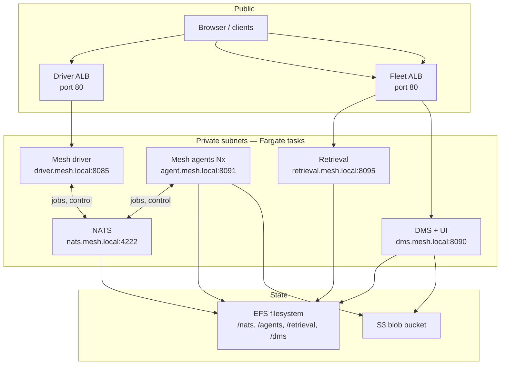
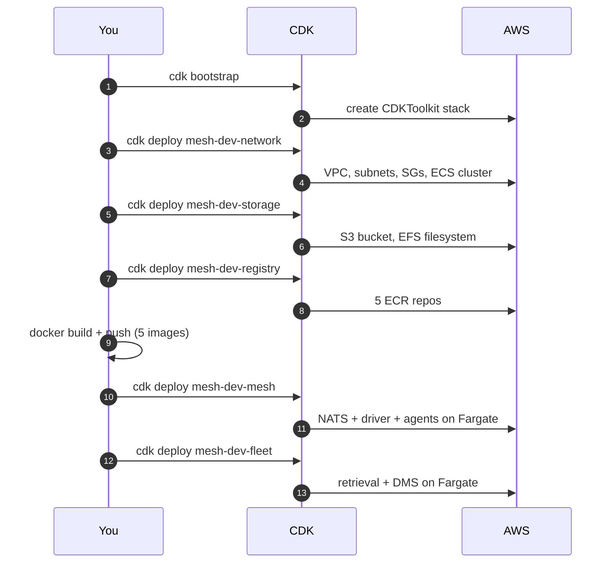

# hitorro-mesh AWS CDK

CDK (TypeScript) that deploys the mesh runtime + backend services to
AWS: **ECS Fargate** for compute, **NATS** for messaging, **EFS** for
stateful volumes, **S3** for content-addressed blobs, **ALB** for
public entry, **ECR** for images.

See [ARCHITECTURE.md](ARCHITECTURE.md) for the full AWS mapping,
diagrams, and cost breakdown.

## What gets deployed



Five ECS Fargate services, all on private subnets. Two public ALBs
route ingress: one to the mesh driver (jobs API + pipelines UI), one
to the fleet services (retrieval API + DMS UI on separate URL paths).

## Prereqs

1. **AWS credentials** in your shell (env vars or `~/.aws/credentials`).
2. **CDK v2** — `brew install aws-cdk` or `npm install -g aws-cdk`.
3. **Node 20+** + **npm** (or pnpm).
4. **Docker running** (only needed when you push images).
5. **The Spring Boot fat jars built** — this deployment assumes
   `mvn install` has produced:
   - `hitorro-mesh-driver-app/target/hitorro-mesh-driver-app-3.0.1.jar`
   - `hitorro-mesh-agent-app/target/hitorro-mesh-agent-app-3.0.1.jar`
   - `hitorro-fleet-retrieval/target/hitorro-fleet-retrieval-3.0.1.jar`
   - `hitorro-dms/hitorro-nosqldms-spring-boot/target/hitorro-nosqldms-spring-boot-0.1.0-app.jar`

## Deploy sequence



### Step by step

```bash
cd hitorro-mesh-examples/deploy/aws-cdk

# 1. Install CDK-app deps
npm install

# 2. One-time CDK toolkit setup in your target account
export REGION=us-east-1
./scripts/bootstrap-aws.sh

# 3. Deploy the foundation stacks
npx cdk deploy mesh-dev-network mesh-dev-storage mesh-dev-registry

# 4. Build + push all service images to ECR
#    (uses the fat jars from the sibling mesh repos)
ENV=dev REGION=us-east-1 TAG=latest ./scripts/build-and-push-images.sh

# 5. Deploy the mesh (NATS + driver + agents)
npx cdk deploy mesh-dev-mesh

# 6. Deploy the fleet (retrieval + DMS)
npx cdk deploy mesh-dev-fleet

# The CDK outputs print the two ALB DNS names — open them in a browser.
```

Total wall-clock: ~15–20 min for a first deploy (NAT gateway
provisioning is the slowest bit). Follow-up deploys are minutes.

## Configuration

Every knob is in `cdk.json` under `context`, overridable per invocation
with `--context key=value`:

| Key | Default | Purpose |
|---|---|---|
| `env` | `dev` | Env tag baked into stack names + resource tags |
| `region` | `us-east-1` | AWS region |
| `imageTag` | `latest` | ECR tag for services to run |
| `singleAz` | `true` | 1 AZ (cheap, dev) vs 2 (HA, prod) |
| `meshAgents` | `2` | Number of agent Fargate replicas |
| `driverMem` / `agentMem` / `natsMem` / `retrievalMem` / `dmsMem` | 1024 / 2048 / 512 / 1024 / 1024 | MiB per task |
| `enableRetrieval` / `enableDms` | `true` / `true` | Skip either service if you don't need it |

Production example:

```bash
npx cdk deploy 'mesh-prod-*' \
  --context env=prod --context singleAz=false \
  --context meshAgents=4 --context agentMem=4096 \
  --context imageTag=v1.2.3
```

## Getting the URLs

After `cdk deploy` prints outputs, or any time later:

```bash
# Driver + pipelines UI
aws cloudformation describe-stacks --stack-name mesh-dev-mesh \
  --query "Stacks[0].Outputs[?OutputKey=='DriverUiUrl'].OutputValue" --output text

# DMS UI + retrieval API
aws cloudformation describe-stacks --stack-name mesh-dev-fleet \
  --query "Stacks[0].Outputs[?OutputKey=='DmsUiUrl'].OutputValue" --output text
aws cloudformation describe-stacks --stack-name mesh-dev-fleet \
  --query "Stacks[0].Outputs[?OutputKey=='RetrievalApiUrl'].OutputValue" --output text
```

## Operational recipes

### Rolling deploy of a new image tag

```bash
ENV=dev TAG=v1.2.4 ./scripts/build-and-push-images.sh
npx cdk deploy mesh-dev-mesh mesh-dev-fleet --context imageTag=v1.2.4
```

CDK produces new task definitions; ECS does a rolling update
(min-healthy 100%, max 200% by default) — no downtime.

### Scale agents up

```bash
npx cdk deploy mesh-dev-mesh --context meshAgents=8
```

### Exec into a running task (debug)

```bash
CLUSTER=$(aws cloudformation describe-stacks --stack-name mesh-dev-network \
    --query "Stacks[0].Outputs[?OutputKey=='ClusterName'].OutputValue" --output text)
TASK=$(aws ecs list-tasks --cluster $CLUSTER --service-name DriverSvc --query 'taskArns[0]' --output text)
aws ecs execute-command --cluster $CLUSTER --task $TASK --container driver --interactive --command '/bin/bash'
```

Enabled on every service via `enableExecuteCommand: true`.

### Teardown

```bash
# fleet first (depends on mesh), then mesh, then foundation
npx cdk destroy mesh-dev-fleet mesh-dev-mesh
npx cdk destroy mesh-dev-registry mesh-dev-storage mesh-dev-network

# NOTE: S3 blob bucket + EFS both have RemovalPolicy: RETAIN so
# your content survives a destroy. Delete them by hand if you
# want them gone:
aws s3 rm s3://<bucket> --recursive && aws s3 rb s3://<bucket>
aws efs delete-file-system --file-system-id <fs-id>
```

## Cost ballpark

Sanity-check numbers, `us-east-1`, `singleAz: true`, defaults, 730 hr/mo:

| Resource | Monthly |
|---|---|
| NAT gateway (1) | ~$32 |
| ALB (2) | ~$32 |
| Fargate: NATS 0.25 vCPU / 512 MB | ~$9 |
| Fargate: driver 0.5 vCPU / 1 GB | ~$18 |
| Fargate: 2× agent 1 vCPU / 2 GB each | ~$72 |
| Fargate: retrieval 0.5 vCPU / 1 GB | ~$18 |
| Fargate: DMS 0.5 vCPU / 1 GB | ~$18 |
| EFS (bursting, first 100 GB) | ~$30 |
| S3 blobs (10 GB) | ~$0.25 |
| CloudWatch logs | ~$3 |
| **Total** | **~$230 / month** |

Switch `singleAz: false` and `meshAgents: 4` and you'll roughly
double.

## Where things map

See the [ARCHITECTURE.md](ARCHITECTURE.md) doc for the full
service-by-service mapping between the mesh concepts and their AWS
resources, plus network topology, IAM boundaries, and observability.
