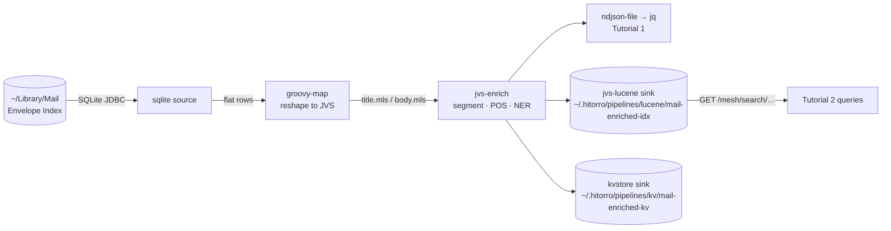

# Mail → JVS Enrichment → Search — Hands-on Tutorial

> **New to mesh pipelines?** Read
> [authoring-a-pipeline.md](../../hitorro-mesh-pipelines/docs/authoring-a-pipeline.md)
> first — it covers the source → steps → sinks model this tutorial
> builds on. For the live-query-over-Kafka case (as opposed to this
> batch-ingest-into-index case), see
> [STREAMING_SQL_TUTORIAL.md](./STREAMING_SQL_TUTORIAL.md). For running
> this ingest on a schedule with a persistent checkpoint, see
> [scheduling.md](../../hitorro-mesh-pipelines/docs/scheduling.md).

Two shipped shell scripts that walk you through the full type-aware
enrichment pipeline against your local Apple Mail database. Every bash
example is copy-pasteable; every REST call has the equivalent `curl`
so you can drive the same features without the wrappers.

- [What you'll build](#what-youll-build)
- [Prereqs](#prereqs)
- [Tutorial 1: `mail-enrich-print.sh` — SQL → enriched JSON to stdout](#tutorial-1-mail-enrich-printsh--sql--enriched-json-to-stdout)
- [Tutorial 2: `mail-enrich-search.sh` — SQL → enriched → Lucene + KV → search](#tutorial-2-mail-enrich-searchsh--sql--enriched--lucene--kv--search)
- [REST-only walkthrough (no scripts)](#rest-only-walkthrough-no-scripts)
- [Query cookbook — logical vs physical field paths](#query-cookbook--logical-vs-physical-field-paths)
- [Where the artifacts land on disk](#where-the-artifacts-land-on-disk)
- [Further reading](#further-reading)

---

## What you'll build



- **Tutorial 1** stops at the `ndjson-file` sink so you can *see* the
  enriched JVS: sentence segmentation, POS tags, and NER bracket
  markup like `[{Chris&&NE_Person}]`.
- **Tutorial 2** fans the same enriched stream into a type-aware
  Lucene index and a RocksDB KV store, then runs searches back
  against the index using logical JVS field paths.

---

## Prereqs

1. Mesh running:
   ```bash
   cd hitorro-mesh-examples/scripts
   ./mesh-up.sh
   ```
2. macOS Apple Mail with a V10 envelope index at
   `~/Library/Mail/V10/MailData/Envelope Index`. If your Mac is on a
   pre-Sonoma OS you may have `V9` / `V8` — edit the `path:` in the
   scripts accordingly.
3. `jq` on `$PATH` for the pretty-print output.
4. Driver reachable at `http://localhost:8085` (adjust `DRIVER` env
   var to override).

Verify with `./mesh-status.sh` — you should see one driver + two
agents up.

---

## Tutorial 1: `mail-enrich-print.sh` — SQL → enriched JSON to stdout

### What it does

1. Opens Mail's SQLite database read-only.
2. Runs an inline `SELECT` (you see the SQL in the script).
3. Reshapes each row into a JVS `mail_email` document — `subject` →
   `title.mls[0].text`, `body preview` → `body.mls[0].text`.
4. Runs `jvs-enrich` with the `[basic, segmented, pos, ner]` tags.
5. Writes rows to a temp NDJSON and pretty-prints them with `jq`.

### Bash examples

```bash
# Default — 5 most recent messages
./mail-enrich-print.sh

# More rows
./mail-enrich-print.sh --limit 20

# Filter — any SQLite WHERE clause spliced into the query
./mail-enrich-print.sh --where "addr.address LIKE '%github.com'"
./mail-enrich-print.sh --where "m.flagged = 1"
./mail-enrich-print.sh --limit 100 --where "subj.subject LIKE '%invoice%'"

# Raw NDJSON — one line per email, pipeable
./mail-enrich-print.sh --limit 3 --raw | jq '.body.mls[0].segmented_ner'
```

### What the output shows

Each block is one email. The `segmented_ner` list is the piece the
Lucene indexer's `NERMarkupTokenFilter` reads at index time — every
`[{token&&NE_Type}]` bracket becomes a term + entity-type token at
the same position.

```
id:       710443
sender:   no-reply@rs.ring.com
subject:  Cellular Backup

body.segmented (first 3 sentences):
  Ring Alarm Update Ring Alarm in Orlando is running on cellular backup as of…
  Check your Internet connection.
  Essential security features will work normally.

body.segmented_ner (first 3 sentences, bracket format):
  Ring [{Alarm&&NE_Person}] [{Update&&NE_Person}] [{Ring&&NE_Person}] …
        [{Orlando&&NE_Location}] is running on cellular backup as of …
  Check your Internet connection .
  Essential security features will work normally .
```

### REST equivalent

The script is a thin wrapper over `POST /mesh/jobs/run` with the
inline YAML in the request body. To reproduce without the script:

```bash
# Write the pipeline YAML to a file
cat > /tmp/mail-enrich.yaml <<'YAML'
job: mail-enrich-print
nodes:
  - id: enrich
    pipeline:
      source:
        kind: sqlite
        path: "~/Library/Mail/V10/MailData/Envelope Index"
        query: |
          SELECT m.ROWID AS id, subj.subject AS subject, summ.summary AS body
          FROM messages m
          LEFT JOIN subjects  subj ON subj.ROWID = m.subject
          LEFT JOIN summaries summ ON summ.ROWID = m.summary
          WHERE subj.subject IS NOT NULL AND summ.summary IS NOT NULL
          ORDER BY m.date_received DESC
          LIMIT 5
      steps:
        - kind: groovy-map
          script: |
            // id is core_id (composite {domain, did, id}) via sysobject —
            // MUST be an object, not a scalar, or the Lucene projection
            // errors "object node expected id.id".
            def sid = String.valueOf(row.id)
            def out = [ht_type: 'mail_email', id: [id: sid, did: sid, domain: 'mail']]
            out.title = [mls: [[lang: 'en', text: row.subject ?: '']]]
            if (row.body != null) out.body = [mls: [[lang: 'en', text: row.body]]]
            out
        - kind: jvs-enrich
          tags: [basic, segmented, pos, ner]
          typeJsonResource: "classpath:/types/mail_email.json"
      sinks:
        - kind: ndjson-file
          url: "file:///tmp/mail-enriched.ndjson"
YAML

# Submit — returns {"jobId": "..."} immediately (202)
curl -sS -X POST http://localhost:8085/mesh/jobs/run \
  -H 'content-type: application/x-yaml' \
  --data-binary @/tmp/mail-enrich.yaml

# Poll status until SUCCEEDED / FAILED
JOB=$(curl -sS -X POST http://localhost:8085/mesh/jobs/run \
  -H 'content-type: application/x-yaml' --data-binary @/tmp/mail-enrich.yaml | jq -r '.jobId')
until curl -sS "http://localhost:8085/mesh/jobs/$JOB" | jq -e '.state | IN("SUCCEEDED","FAILED")' > /dev/null; do sleep 1; done

# Inspect the enriched output
jq '.body.mls[0].segmented_ner' < /tmp/mail-enriched.ndjson
```

The scripts also emit live SSE progress:

```bash
curl -N "http://localhost:8085/mesh/jobs/$JOB/stream"
```

---

## Tutorial 2: `mail-enrich-search.sh` — SQL → enriched → Lucene + KV → search

### What it does

Same source + enrichment as Tutorial 1, but the sinks list is:

- `jvs-lucene` — type-aware index at
  `~/.hitorro/pipelines/lucene/mail-enriched-idx/`. Every field
  projected per its JVS type (identifier → `StringField`, text →
  language-analysed `TextField`, `segmented_ner` → `textmarkup`
  bracket-parsing analyzer, etc.). Writes a `.jvs-type.json`
  sidecar so the search service knows how to expand logical field
  paths.
- `kvstore` — RocksDB at `~/.hitorro/pipelines/kv/mail-enriched-kv/`
  keyed by `id`, value is the full enriched JVS.

After indexing the script fires demo queries against
`GET /mesh/search/mail-enriched-idx`.

### Bash examples

```bash
# Default — 200 rows, run default demo searches
./mail-enrich-search.sh

# Larger corpus
./mail-enrich-search.sh --limit 500

# Wipe the index + KV first (needed after schema changes)
./mail-enrich-search.sh --limit 500 --wipe

# Custom searches — --search is repeatable, uses logical JVS paths
./mail-enrich-search.sh \
  --search 'body.mls.segmented_ner:NE_Person' \
  --search 'body.mls.clean:kubernetes' \
  --search 'sender_domain:github.com'

# Search without re-ingesting (index already populated)
./mail-enrich-search.sh --skip-run --search 'title.mls.clean:invoice'
```

### REST equivalent — the search endpoint

The mesh exposes `GET /mesh/search/<indexName>?q=<query>&limit=<n>`.
`q` is Lucene query syntax; you can use logical JVS field paths and
the search service expands them via the type sidecar.

```bash
INDEX=mail-enriched-idx

# List indexes on-disk
curl -sS http://localhost:8085/mesh/search | jq

# Match-all
curl -sS "http://localhost:8085/mesh/search/$INDEX?q=*:*&limit=1"

# Full-text over cleaned body (stemmed English)
curl -sS --get "http://localhost:8085/mesh/search/$INDEX" \
  --data-urlencode 'q=body.mls.clean:ring alarm'

# Filter by NER entity type
curl -sS --get "http://localhost:8085/mesh/search/$INDEX" \
  --data-urlencode 'q=body.mls.segmented_ner:NE_Person'

# Exact-match identifier field
curl -sS --get "http://localhost:8085/mesh/search/$INDEX" \
  --data-urlencode 'q=sender_domain:github.com'

# Boolean AND / OR / NOT
curl -sS --get "http://localhost:8085/mesh/search/$INDEX" \
  --data-urlencode 'q=+body.mls.segmented_ner:NE_Person -sender_domain:no-reply@rs.ring.com'

# Get just the count via jq
curl -sS --get "http://localhost:8085/mesh/search/$INDEX" \
  --data-urlencode 'q=body.mls.segmented_ner:NE_Location' | jq '.hitCount'

# Extract the enriched NER for the first hit
curl -sS --get "http://localhost:8085/mesh/search/$INDEX" \
  --data-urlencode 'q=body.mls.segmented_ner:NE_Person' \
  --data-urlencode 'limit=1' \
  | jq '.hits[0].body.mls[0].segmented_ner'
```

Response shape:

```json
{
  "index": "mail-enriched-idx",
  "query": "body.mls.segmented_ner:NE_Person",
  "totalDocsInIndex": 500,
  "hitCount": 20,
  "tookMs": 8,
  "hits": [ { "id": "710443", "title": {...}, "body": {...}, ... } ]
}
```

- `totalDocsInIndex` — every document currently in the segment.
- `hitCount` — number of rows returned in this response (capped by
  `limit`, default 20, max 1000).
- `hits[i]` — the stored `_source` JVS if the sink used
  `storeSource: true` (default), otherwise a synthesised row of the
  stored fields.

---

## REST-only walkthrough (no scripts)

Reproduce Tutorial 2's pipeline end-to-end using only `curl`:

```bash
# 1) Submit — returns {"jobId": "..."} immediately
JOB=$(curl -sS -X POST http://localhost:8085/mesh/jobs/run \
  -H 'content-type: application/x-yaml' \
  --data-binary @- <<'YAML' | jq -r '.jobId'
job: mail-rest-tutorial
nodes:
  - id: enrich-and-index
    pipeline:
      source:
        kind: sqlite
        path: "~/Library/Mail/V10/MailData/Envelope Index"
        query: |
          SELECT m.ROWID AS id, addr.address AS sender_address,
                 subj.subject AS subject, summ.summary AS body
          FROM messages m
          LEFT JOIN addresses addr ON addr.ROWID = m.sender
          LEFT JOIN subjects  subj ON subj.ROWID = m.subject
          LEFT JOIN summaries summ ON summ.ROWID = m.summary
          WHERE subj.subject IS NOT NULL AND summ.summary IS NOT NULL
          ORDER BY m.date_received DESC LIMIT 100
      steps:
        - kind: groovy-map
          script: |
            // id is core_id (composite {domain, did, id}) via sysobject —
            // MUST be an object, not a scalar, or the Lucene projection
            // errors "object node expected id.id".
            def sid = String.valueOf(row.id)
            def out = [ht_type: 'mail_email', id: [id: sid, did: sid, domain: 'mail']]
            out.title = [mls: [[lang: 'en', text: row.subject ?: '']]]
            if (row.body != null) out.body = [mls: [[lang: 'en', text: row.body]]]
            out.sender_address = row.sender_address
            def at = (row.sender_address ?: '').indexOf('@')
            out.sender_domain = at > 0 ? row.sender_address.substring(at + 1).toLowerCase() : null
            out
        - kind: jvs-enrich
          tags: [basic, segmented, pos, ner]
          typeJsonResource: "classpath:/types/mail_email.json"
      sinks:
        - kind: jvs-lucene
          name: rest-tutorial-idx
          typeJsonResource: "classpath:/types/mail_email.json"
        - kind: kvstore
          name: rest-tutorial-kv
          keyExpr: id
YAML
)
echo "jobId=$JOB"

# 2) Wait for completion
until curl -sS "http://localhost:8085/mesh/jobs/$JOB" \
      | jq -e '.state | IN("SUCCEEDED","FAILED","CANCELLED")' > /dev/null; do sleep 1; done
curl -sS "http://localhost:8085/mesh/jobs/$JOB" | jq '{state, nodes: [.nodes[] | {id, state, rowsIn, rowsOut, sinkCounts}]}'

# 3) Query the fresh index
curl -sS --get "http://localhost:8085/mesh/search/rest-tutorial-idx" \
  --data-urlencode 'q=body.mls.segmented_ner:NE_Location' | jq '.hitCount, .hits[0].title.mls[0].text'
```

---

## Query cookbook — logical vs physical field paths

The `jvs-lucene` sink projects each field per its JVS type into
Lucene fields with names like `<path>.<method>_<lang>_<s|m>`. You
don't need to know that scheme in queries — the search service loads
the type sidecar and rewrites logical paths automatically.

| Logical path (what to type)         | Physical projected name             | Method / analyzer                          |
| ------------------------------------ | ------------------------------------ | ------------------------------------------ |
| `title.mls.text`                    | `title.mls.text_en_m`               | English `StandardAnalyzer` + stemmer       |
| `title.mls.clean`                   | `title.mls.clean.text_en_m`         | same, over cleaned text                    |
| `body.mls.text`                     | `body.mls.text_en_m`                | same                                        |
| `body.mls.segmented_ner`            | `body.mls.segmented_ner.textmarkup_en_m` | NER-bracket parser + language stemmer |
| `sender_domain`                     | `sender_domain.identifier_s`        | `StringField` (exact match)                |
| `size_bytes`                        | `size_bytes.long_s`                 | `LongPoint` (range + sort)                 |

Rules:

- Logical paths route through `JVSQueryParser` when an index has a
  `.jvs-type.json` sidecar (all `jvs-lucene` sinks write one).
- Physical names still parse unchanged — safe to keep old queries.
- Missing type / missing sidecar → the search service falls back to
  a plain `QueryParser` over the synthetic `_text` catch-all, so
  every `q=` still returns something even for unclassified indexes.

### Escaping and quoting

Lucene query syntax reserves `+ - && || ! ( ) { } [ ] ^ " ~ * ? : \ /`.
When calling `curl` from a shell, always use `--data-urlencode` so
the shell doesn't eat the `+` / `:` / spaces:

```bash
# WRONG — shell splits the space, `+is_newsletter` becomes " is_newsletter"
curl "http://localhost:8085/mesh/search/idx?q=+body:foo +title:bar"

# RIGHT
curl --get "http://localhost:8085/mesh/search/idx" \
  --data-urlencode 'q=+body:foo +title:bar'
```

---

## Where the artifacts land on disk

Everything lives under `~/.hitorro/pipelines/` (override with the
`hitorro.pipelines.home` system property).

```
~/.hitorro/pipelines/
├── lucene/
│   ├── mail-enriched-idx/         ← Tutorial 2 default index
│   │   ├── _0.cfs, segments_2 …   ← Lucene segments
│   │   └── .jvs-type.json         ← type sidecar (used by JVSQueryParser)
│   ├── mail-jvs-enriched/         ← full mail-to-jvs-enriched.yaml index
│   └── rest-tutorial-idx/         ← REST walkthrough
└── kv/
    ├── mail-enriched-kv/          ← RocksDB (LOCK, MANIFEST, *.log)
    └── rest-tutorial-kv/
```

- Wipe an index or KV: `rm -rf ~/.hitorro/pipelines/lucene/<name>`
  (or `kv/<name>`). Next pipeline run recreates it.
- `--wipe` on `mail-enrich-search.sh` does the two `rm -rf` for you.

---

## Common gotchas

### `PropaccessError: object node expected id.id`

Symptom: pipeline runs, per-row failures spam the driver log, some
rows may still get indexed depending on where the failure is caught.
The failing row's `id` is a scalar (`"1"`) where the type system
expected an object.

Cause: `sysobject.id` is `core_id`, a composite `{domain, did, id}`.
When you write:

```groovy
out.id = String.valueOf(row.id)         // WRONG — bare string
```

the type-aware Lucene projection walks `id.id` and hits a `TextNode`
instead of an `ObjectNode`. Fix:

```groovy
def sid = String.valueOf(row.id)
out.id = [id: sid, did: sid, domain: 'mail']   // correct — object
```

`domain` distinguishes id namespaces across source systems (`mail`,
`photos`, etc.) so ids don't collide when you merge indexes.

### Job says `RUNNING` forever in the UI

If a groovy-map or enrichment step throws while the runner's
exception handling doesn't propagate to the job state, the UI keeps
polling `RUNNING`. Two things to check:

1. `GET /mesh/jobs/{jobId}` (skip the UI) — look at `error` and
   `nodes[].error`.
2. `tail /tmp/hitorro-mesh-smoke/logs/driver.log` — the real stack
   trace lands there. Grep for `PropaccessError`, `NoClassDefFound`,
   `ClassNotFoundException`, `IOException`.

### `classpath resource not found: types/xxx.json`

Your groovy uses `typeJsonResource: "classpath:/types/mail_xxx.json"`
but the file isn't in a jar the driver loaded. Options:

- Add the type JSON to `hitorro-mesh-pipelines-sqlite/src/main/resources/types/`
  and rebuild both the sqlite module AND the driver-app fat jar
  (Spring Boot repackages deps into `BOOT-INF/lib/`).
- Or point at the on-disk copy:
  `typeJsonResource: "file:/Users/chris/hitorro/config/types/mail_xxx.json"`
  — no rebuild needed, iterate fast.

### `NoClassDefFoundError: Iso639Table`

`jvs-enrich` needs `HT_HOME` + `HT_DATA` env vars set so language
tables load. `mesh-up.sh` exports both — if you're running the
driver JVM by hand, `export HT_HOME=$(pwd) HT_DATA=$HT_HOME/data`
before starting.

---

## Further reading

- **[CLI_USERGUIDE.md](CLI_USERGUIDE.md)** — full `mesh-pipeline.sh`
  reference, YAML inventory across all shipped example jobs, and
  the debug playbook.
- **[scripts/README.md](../scripts/README.md)** — mesh bootstrap
  (nats + driver + two agents on localhost).
- **`hitorro-mesh-pipelines-sqlite/src/main/resources/examples/jobs/mail-to-jvs-enriched.yaml`**
  — the full-annotated version of the pipeline these tutorials
  simplify.
- **`hitorro-mesh-pipelines-sqlite/src/main/resources/types/mail_email.json`**
  — the JVS type driving field projection + enrichment output shape.
- **`hitorro-index/src/main/java/com/hitorro/index/query/JVSQueryParser.java`**
  — the logical-path → physical-projection rewriter.
